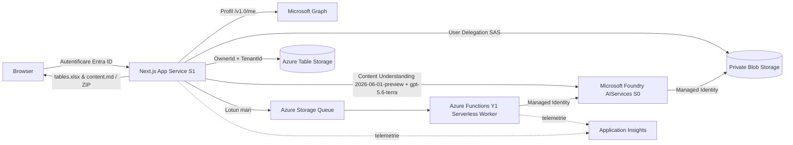

# Document Processor — Portal OCR & Extracție Tabele (Azure Content Understanding + Foundry LLM)

[](https://portal.azure.com/#create/Microsoft.Template/uri/https%3A%2F%2Fraw.githubusercontent.com%2Feduardplesu%2Fmfib-document-processor%2Fmain%2Finfra%2Fazuredeploy.json)
[](./LICENSE)

Portal web securizat (Next.js 15 + Azure Functions Serverless + **Azure Content Understanding `prebuilt-layout` (`2026-06-01-preview`)** + **Foundry OpenAI `gpt-5.6-terra`**) pentru procesarea OCR de înaltă precizie a documentelor scanate și capturilor de ecran (PDF, JPG, PNG, TIFF), reconstrucția fidelă a tabelelor complexe în **Excel (`tables.xlsx`)** și extragerea structurată + rafinată contextual a conținutului în **Markdown (`content.md`)**, cu descărcare individuală sau ca arhivă **ZIP** și curățare completă a sesiunii de lucru.

> **Notă importantă privind acuratețea OCR și licențierea:** Rezultatele OCR sunt un instrument de pre-procesare și pot conține erori în funcție de calitatea scanării. Verificați manual valorile financiare sau juridice critice. Acest software este oferit sub licența **MIT**, **„AS IS” (ca atare), fără nicio garanție expresă sau implicită** — vezi [LICENSE](./LICENSE).

---

## Funcționalități principale

- **Ecran dedicat de autentificare (Auth Gate)** înainte de intrarea în aplicație, integrat cu **Microsoft Entra ID** (App Service Easy Auth v2 fără client secret, folosind *User-Assigned Managed Identity* + *Federated Identity Credential*) și afișarea numelui complet din **Microsoft Graph** (`/v1.0/me`), cu suport complet și pentru utilizatori **B2B Guest**.
- **Izolare strictă per utilizator și tenant (`OwnerId` + `TenantId`)**: fiecare utilizator autentificat își vede, procesează, descarcă și șterge exclusiv propriile documente. Niciun utilizator nu poate accesa documentele altui coleg.
- **Upload direct în Azure Blob Storage** prin URL-uri SAS de delegare cu durată scurtă (*User Delegation SAS*), fără expunerea cheilor de stocare (`allowSharedKeyAccess: false`, `allowBlobPublicAccess: false`).
- **Motor hibrid de ultimă generație: Azure Content Understanding (`2026-06-01-preview`) + Foundry LLM (`gpt-5.6-terra`)**:
  - **Extracție sincronă în memorie (`prebuilt-layout:analyzeBinaryInline`, API `2026-06-01-preview`)**: extrage instantaneu tabelele, paragrafele, secțiunile, hiperlinkurile și structura documentului, cu fallback automat la analiza asincronă pentru documente mari.
  - **Rafinare inteligentă post-OCR cu `gpt-5.6-terra`**: corectează în context erorile optice de scanare/capturi de ecran în limba română (de ex. litere confundate pe rezoluții mici sau artefacte de pictograme UI), păstrând 100% intacte sumele financiare, codurile, referințele legale și tabelele.
- **Exporturi curate, orientate către utilizator**:
  - **`tables.xlsx`**: fișier Excel generat cu ExcelJS, cu foaie `Summary` și câte o foaie separată pentru fiecare tabel detectat (`T1_P1`, `T2_P1` etc.), păstrând diacriticele românești, celulele îmbinate (`rowSpan` / `columnSpan`), valorile negative și prevenind *formula injection* (toate celulele sunt stocate ca text `@`).
  - **`content.md`**: textul integral și structura documentului (titluri, paragrafe, liste, tabele) în format Markdown, curățat de erori optice.
- **Descărcare în masă (`Selectează toate` + `Descarcă selecția ca ZIP`)**: generare rapidă a arhivei ZIP și declanșare automată a descărcării în browser.
- **Curățare sesiune (`Curăță sesiunea`)**: după descărcarea rezultatelor, utilizatorul poate șterge printr-un singur clic toate fișierele de intrare (`staging`, `incoming`), rezultatele intermediare (`results`), exporturile și arhivele (`outputs`) + înregistrările din Table Storage aferente sesiunii sale.
- **Indicatori vizuali de stare colorați**:
  - **Finalizat** (verde), **În curs de procesare / În așteptare** (mov), **Necesită verificare** (galben/ambră), **Eroare** (roșu), **Se încarcă** (albastru).

---

## Arhitectură



### Resurse Azure provizionate automat (ARM / Bicep)

| Resursă | Serviciu Azure | Configurație / SKU |
|---|---|---|
| Portal Web & API | Azure App Service (Linux) | Plan `S1`, runtime `NODE\|24-lts`, `asyncScalingEnabled: true` |
| Worker Asincron | Azure Functions (Serverless) | Plan Consumption `Y1` (`Dynamic` — 0 € cost fix lunar, pay-per-execution; trece pe `EP1` doar dacă `enablePrivateNetworking = true`) |
| Stocare Documente | Azure Storage Account | `Standard_LRS`, containere private (`staging`, `incoming`, `results`, `outputs`, `function-packages`), cozi (`document-jobs`, `archive-jobs`), tabele (`Jobs`, `Documents`, `Archives`) |
| Motor OCR & LLM | Microsoft Foundry (`AIServices`) | `AIServices` SKU `S0`, Content Understanding `prebuilt-layout` (`2026-06-01-preview`) + deployment OpenAI **`gpt-5.6-terra`** (`GlobalStandard`) |
| Identitate Auth | User-Assigned Managed Identity | Folosită ca *Federated Credential* pentru Entra Easy Auth (fără client secret) |
| Monitorizare | Log Analytics + Application Insights | Workspace-based |
| Autorizare Date | Azure RBAC Role Assignments | `Cognitive Services User`, `Cognitive Services OpenAI User` și rolurile Storage pe Managed Identity |

---

## Ghid de instalare rapidă pentru clienți (Pas cu Pas)

Orice organizație poate instala o instanță complet independentă în propriul tenant Microsoft Entra ID și propriul abonament Azure folosind **fie șablonul ARM precompilat (`infra/azuredeploy.json`)**, **fie scripturile PowerShell + Bicep**.

### Cerințe preliminare

- Un abonament Azure activ cu permisiuni de creare resurse și atribuire roluri RBAC (`Owner` sau `Contributor` + `User Access Administrator`).
- Permisiuni în Microsoft Entra ID pentru a înregistra o aplicație (*Application Developer* / *Cloud Application Administrator*).
- [Azure CLI](https://learn.microsoft.com/cli/azure/install-azure-cli), [PowerShell 7+](https://learn.microsoft.com/powershell/) și [Node.js 24 LTS](https://nodejs.org/) (pentru compilarea și publicarea codului aplicației).

---

### Pasul 1: Crearea înregistrării aplicației în Microsoft Entra ID

Autentificați-vă în Azure CLI și creați înregistrarea aplicației single-tenant:

```powershell
az login --tenant <TENANT_ID>
az account set --subscription <SUBSCRIPTION_ID>

$clientId = az ad app create `
  --display-name "Document Processor" `
  --sign-in-audience AzureADMyOrg `
  --enable-id-token-issuance true `
  --query appId -o tsv

Write-Host "Entra Application (Client) ID: $clientId"
```

---

### Pasul 2: Instalarea infrastructurii Azure (3 opțiuni)

#### Opțiunea A — Instalare vizuală 1-Click în Portalul Azure (ARM Template)

1. Apăsați butonul de mai jos pentru a deschide șablonul ARM [infra/azuredeploy.json](./infra/azuredeploy.json) direct în Azure Portal:

   [](https://portal.azure.com/#create/Microsoft.Template/uri/https%3A%2F%2Fraw.githubusercontent.com%2Feduardplesu%2Fmfib-document-processor%2Fmain%2Finfra%2Fazuredeploy.json)

2. Selectați **Subscription**, creați sau alegeți un **Resource group** (de exemplu `rg-document-processor`) și regiunea dorită (de exemplu `West Europe`).
3. Completați parametrul **`Entra Application Client Id`** cu valoarea `$clientId` obținută la Pasul 1 (și opțional `Organization Name` / `App Display Name`).
4. Apăsați **Review + create** → **Create**.
5. La finalizarea deploymentului, deschideți secțiunea **Outputs** a deploymentului și notați valorile:
   - `portalUrl`
   - `appName`
   - `functionAppName`
   - `storageAccountName`
   - `authManagedIdentityPrincipalId`

#### Opțiunea B — Instalare din linia de comandă cu ARM Template (`infra/azuredeploy.json`)

Dacă preferați instalarea din CLI fără a folosi Bicep, utilizați direct fișierul ARM [infra/azuredeploy.json](./infra/azuredeploy.json) (puteți porni și de la [infra/azuredeploy.parameters.example.json](./infra/azuredeploy.parameters.example.json)):

```powershell
$rg = "rg-document-processor"
$location = "westeurope"
$tenantId = az account show --query tenantId -o tsv

az group create --name $rg --location $location

az deployment group create `
  --resource-group $rg `
  --template-file .\infra\azuredeploy.json `
  --parameters `
    environmentName=prod `
    location=$location `
    resourcePrefix=docproc `
    tenantId=$tenantId `
    entraApplicationClientId=$clientId `
    appDisplayName="Document Processor" `
    organizationName="Numele Organizației" `
    brandingMode=custom
```

#### Opțiunea C — Instalare automată cu scriptul PowerShell și Bicep (`scripts/deploy.ps1`)

Scriptul [scripts/deploy.ps1](./scripts/deploy.ps1) validează șablonul, rulează `what-if` și provizionează infrastructura când primiți flagul `-ConfirmDeployment`:

```powershell
.\scripts\deploy.ps1 `
  -SubscriptionId <SUBSCRIPTION_ID> `
  -TenantId <TENANT_ID> `
  -EnvironmentName prod `
  -Location westeurope `
  -ResourceGroupName rg-document-processor `
  -EntraApplicationClientId $clientId `
  -ConfirmDeployment
```

---

### Pasul 3: Configurarea autentificării Entra ID (fără Client Secret)

Rulați scriptul [scripts/setup-entra.ps1](./scripts/setup-entra.ps1) folosind output-urile `portalUrl` și `authManagedIdentityPrincipalId` rezultate la Pasul 2. Acesta configurează automat:
- Redirect URI-ul Easy Auth (`https://<portal>/ .auth/login/aad/callback`)
- Rolurile aplicației (`Processor.User` și `Processor.Admin`)
- Permisiunea delegată Microsoft Graph `User.Read`
- *Federated Identity Credential* pentru identitatea administrată a App Service-ului (fără niciun secret care să expire)

```powershell
.\scripts\setup-entra.ps1 `
  -TenantId <TENANT_ID> `
  -AppDisplayName "Document Processor" `
  -ExistingClientId $clientId `
  -PortalUrl <PORTAL_URL> `
  -AuthManagedIdentityPrincipalId <AUTH_MANAGED_IDENTITY_PRINCIPAL_ID>
```

Apoi, în **Azure Portal → Microsoft Entra ID → Enterprise applications → Document Processor → Users and groups**, atribuiți utilizatorilor (atât membri interni, cât și utilizatori externi invitați ca **B2B Guest**) sau grupurilor dorite rolul **`Processor User`** (sau `Processor Admin`). Scriptul acordă și *tenant-wide admin consent* pentru `User.Read`, astfel încât utilizatorii **Guest** să se poată autentifica direct, fără ecran de aprobare administrativă.

---

### Pasul 4: Compilarea și publicarea codului aplicației

După provizionarea infrastructurii, compilați și publicați aplicația Next.js și workerul Azure Functions (fie manual din CLI, fie prin workflow-ul GitHub Actions [.github/workflows/deploy.yml](./.github/workflows/deploy.yml)):

```powershell
npm ci
npm run build --workspace @mfib/document-functions
npm run build
```

Pentru detalii suplimentare despre arhitectură, securitate și operare, consultați:
- [docs/architecture.md](./docs/architecture.md)
- [docs/deployment.md](./docs/deployment.md)
- [docs/security.md](./docs/security.md)

---

## Dezvoltare locală și testare

1. Copiați `.env.example` în `.env.local` și configurați un cont Azure Storage de dezvoltare (sau Azurite), plus `DEV_AUTH_ENABLED=true` și `DEV_USER_ID=local-dev-user` (activ doar când `NODE_ENV !== "production"`).
2. Instalați dependențele și rulați verificările:

```powershell
npm install
npm test
npm run typecheck
npm run lint
npm run build --workspace @mfib/document-functions
npm run build
```

---

## Licență și declinarea responsabilității (MIT — „AS IS”)

Acest proiect este distribuit sub **Licența MIT** ([LICENSE](./LICENSE)).

Codul sursă, șabloanele de infrastructură (ARM / Bicep), scripturile și documentația sunt furnizate **„CA ATARE” („AS IS”)**, fără nicio garanție, expresă sau implicită, inclusiv, dar fără a se limita la, garanțiile de vandabilitate, adecvare pentru un anumit scop și neîncălcare a drepturilor. În niciun caz autorii nu vor fi răspunzători pentru nicio pretenție, daună sau altă răspundere rezultată din utilizarea acestui software.

